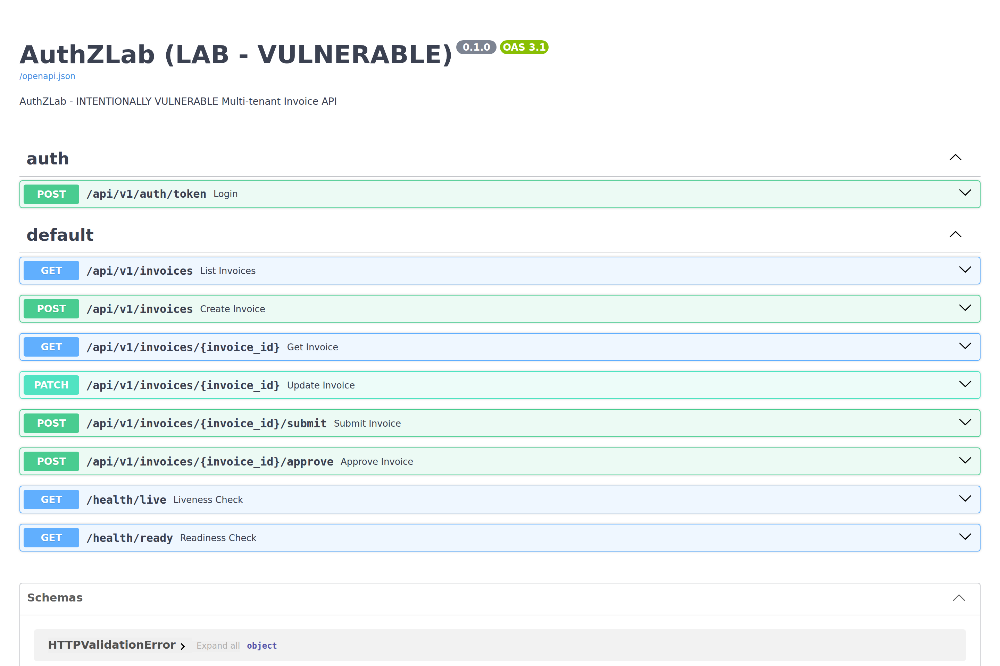
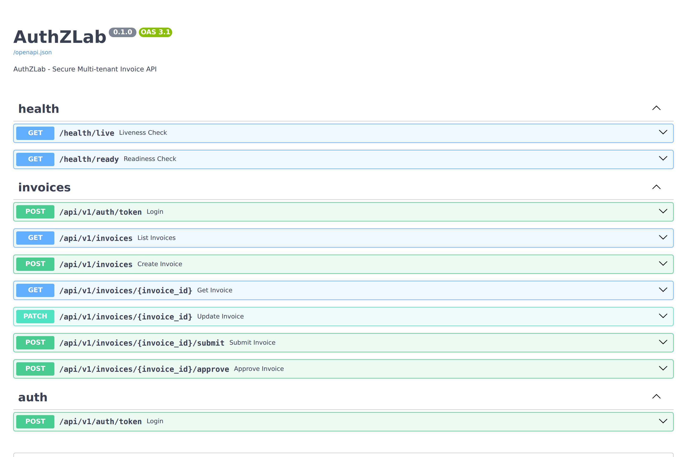
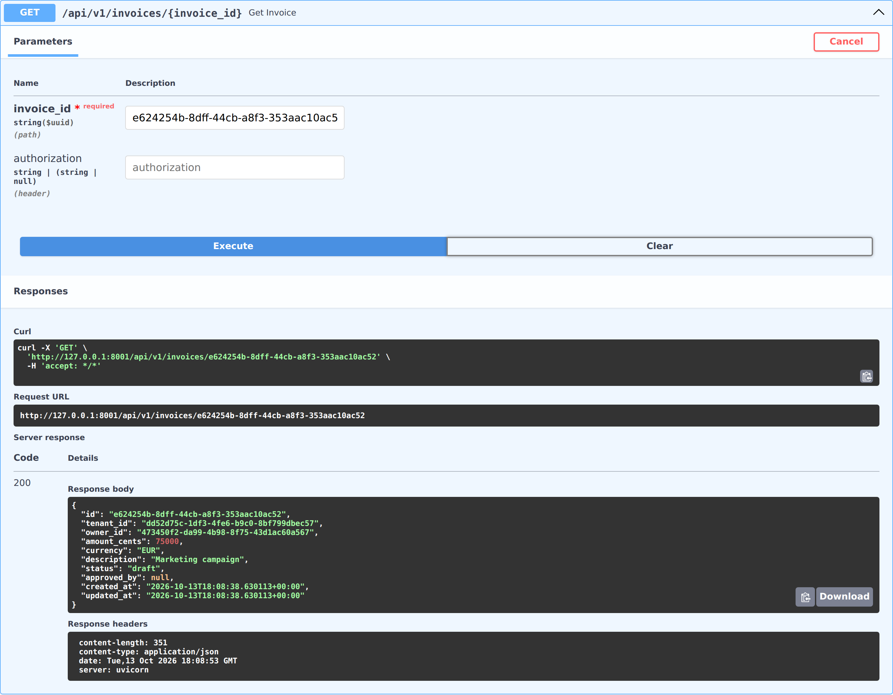
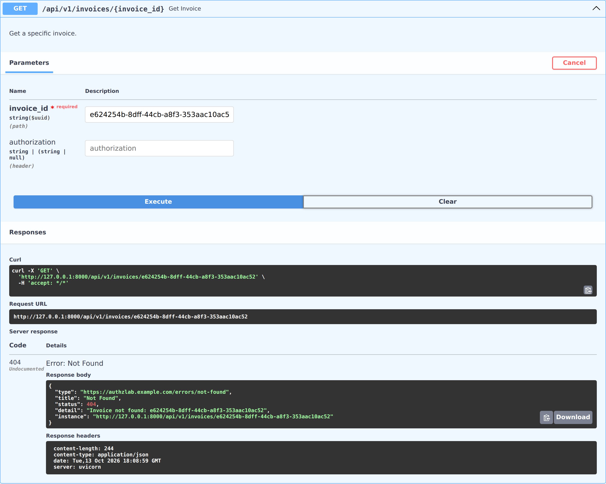
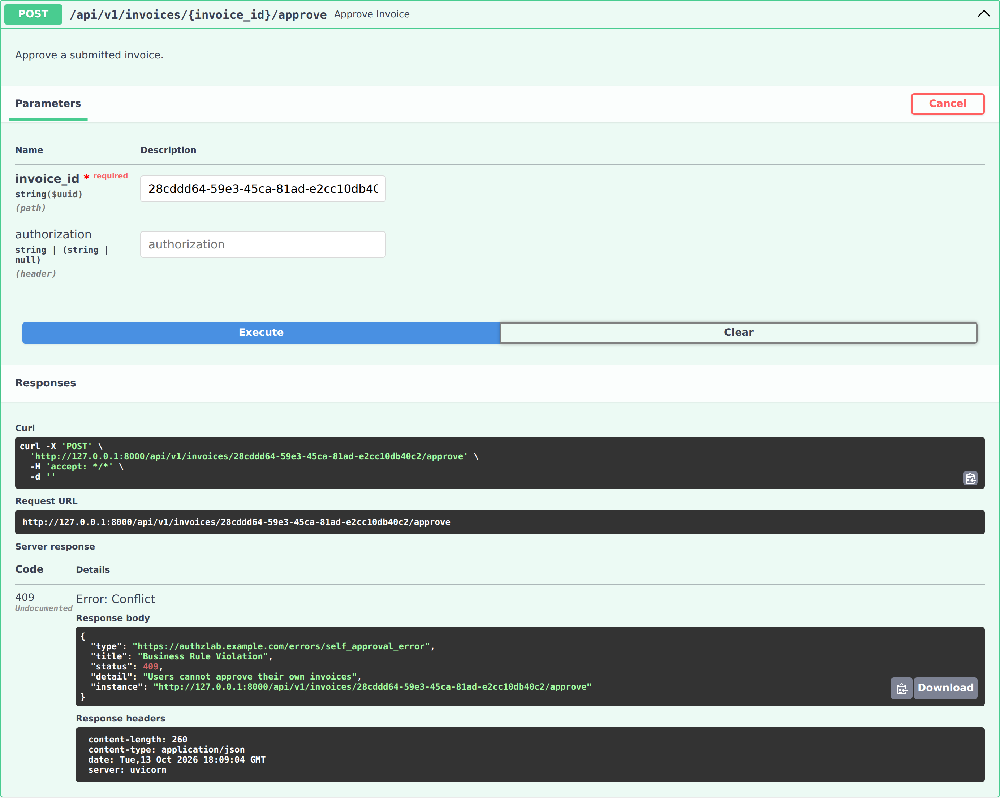
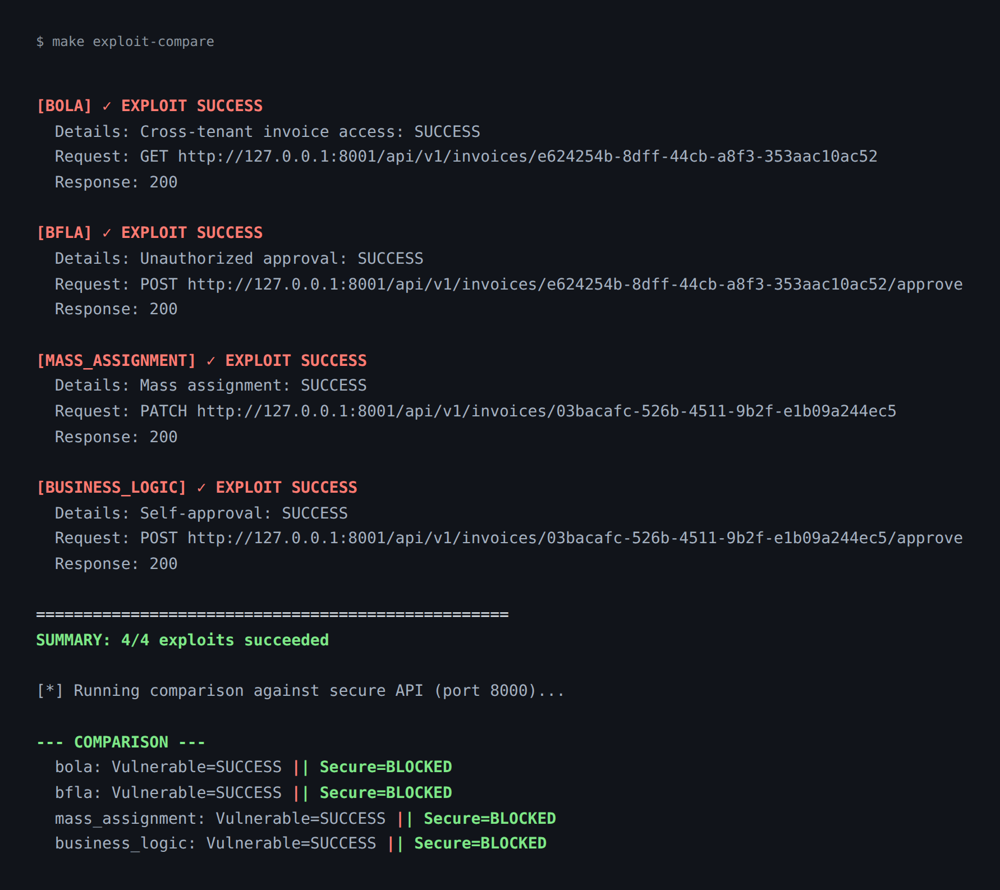

# AuthZLab: Multi-tenant API Authorization Security Laboratory

[](https://python.org)
[](https://fastapi.tiangolo.com)
[](LICENSE)
[](https://github.com/stefanicla/authzlab-api-security-lab/actions/workflows/ci.yml)

**AuthZLab** is a production-style, security-focused Python REST API demonstrating real, reproducible authorization vulnerabilities in a multi-tenant SaaS application. It implements the complete security engineering lifecycle: vulnerability modeling, exploit reproduction, secure remediation, and automated regression testing.

> ⚠️ **WARNING**: This project contains intentionally vulnerable code for educational purposes. The vulnerable lab application (`authzlab-lab`) must only run in isolated local environments. Never expose it to untrusted networks.

## Table of Contents

- [What AuthZLab Demonstrates](#what-authzlab-demonstrates)
- [Architecture](#architecture)
- [Screenshots](#screenshots)
- [Quick Start](#quick-start)
- [Run with Docker Compose](#run-with-docker-compose)
- [Demo Accounts](#demo-accounts)
- [API Endpoints](#api-endpoints)
- [Vulnerability Details](#vulnerability-details)
- [Testing](#testing)
- [CI/CD Pipeline](#cicd-pipeline)
- [Troubleshooting](#troubleshooting)
- [Documentation](#documentation)
- [Security](#security)
- [License](#license)
- [Known Limitations](#known-limitations)

## What AuthZLab Demonstrates

| Scenario | Vulnerability | OWASP API Top 10 | CWE |
|----------|---------------|------------------|-----|
| **LAB-01** | BOLA/IDOR - Cross-tenant invoice access | API1:2023 | CWE-639 |
| **LAB-02** | BFLA - Unauthorized invoice approval | API5:2023 | CWE-862 |
| **LAB-03** | Mass Assignment - Protected field modification | API3:2023 | CWE-915 |
| **LAB-04** | Business Logic - Self-approval violation | API4:2023 | CWE-840 |

Each vulnerability:
- Exists in executable application logic (not mocked)
- Affects real persisted database state
- Has a reproducible exploit via HTTP requests
- Is remediated in the secure variant
- Has automated regression tests proving the fix

## Architecture

```
┌─────────────────────────────────────────────────────────────────┐
│                        AuthZLab Architecture                      │
├─────────────────────────────────────────────────────────────────┤
│                                                                 │
│  ┌──────────────┐    ┌──────────────┐    ┌──────────────────┐  │
│  │   Client     │    │   Client     │    │  Exploit Runner  │  │
│  │  (Secure)    │    │   (Lab)      │    │  (scripts/)      │  │
│  └──────┬───────┘    └──────┬───────┘    └────────┬─────────┘  │
│         │                   │                       │            │
│         ▼                   ▼                       ▼            │
│  ┌──────────────────────────────────────────────────────────┐   │
│  │                    Docker Network                         │   │
│  │  ┌─────────────┐  ┌─────────────┐  ┌─────────────────┐   │   │
│  │  │ API Secure  │  │ API Lab     │  │ PostgreSQL 18   │   │   │
│  │  │ :8000       │  │ :8001       │  │ :5432           │   │   │
│  │  │ (secure)    │  │ (vulnerable)│  │ (two isolated   │   │   │
│  │  │             │  │             │  │  databases)     │   │   │
│  │  └─────────────┘  └─────────────┘  └─────────────────┘   │   │
│  └──────────────────────────────────────────────────────────┘   │
│                                                                 │
└─────────────────────────────────────────────────────────────────┘
```

### Technology Stack

- **Language**: Python 3.14
- **Framework**: FastAPI 0.115+
- **Database**: PostgreSQL 18 with SQLAlchemy 2.x (sync)
- **Auth**: JWT (RS256) + Argon2id password hashing
- **Validation**: Pydantic v2
- **Schema**: SQLAlchemy `init_db()` from models (Alembic reserved for future migrations — see `docs/development/clean-setup-verification.md`)
- **Package Manager**: uv
- **Testing**: pytest + HTTPX
- **Quality**: Ruff, mypy, Semgrep, Trivy
- **Container**: Docker Compose

## Screenshots

Everything below was captured from a running local instance (`make db-reset && make seed`, then both APIs started), not mocked. Invoice IDs are regenerated by every seed, so they differ from one run to the next.

**The vulnerable lab**, Swagger UI on port 8001:



The secure API exposes the same contract under a different title. This capture
predates the OpenAPI tag fix: its single Login operation appears under both
groups. The current schema tags it only as `auth` (covered by a regression test).



### LAB-01 in two pictures

`charlie@acme.com` is a **member of Acme Corp**. The requested invoice belongs to
**Globex Inc** and is not his. The bearer token is sent in the `Authorization`
header; Swagger renders the request before the header is attached, so it is not
visible in the captured frame.

The vulnerable app has no tenant filter and answers `200` with the foreign
record:



The secure app answers `404` with an RFC 9457 problem detail, so the response is
indistinguishable from an invoice that never existed:



### LAB-04

`bob@acme.com` is an **approver at Acme Corp** and owns the submitted invoice he
tries to approve. The secure API refuses with `409 Conflict` (separation of
duties), where the vulnerable app would return `200`:



### Full sweep

`make exploit-compare` runs all four scenarios against the lab and then repeats
them against the secure API. Exit code `1` means at least one exploit landed:



## Quick Start

### Prerequisites

All commands in this README go through the `Makefile`, so `make` is required in
addition to `git` and `uv`. On Linux and macOS it is usually preinstalled
(`sudo apt install build-essential` on Debian/Ubuntu, `xcode-select --install`
on macOS). On Windows, run everything inside WSL 2 (Ubuntu 24.04+ recommended),
where `make` and `git` are available after `sudo apt install make git`.

- `git` - version control
- [`uv`](https://docs.astral.sh/uv/) - Python package manager, `curl -LsSf https://astral.sh/uv/install.sh | sh`
- `make` - task runner used by every command below
- Docker (or Docker Desktop with WSL 2 integration on Windows)
- Python is **not** required: `uv` provisions the pinned 3.14 toolchain

> Windows users: Docker Desktop with WSL 2 integration is the simplest setup,
> but any Docker Engine exposing a local TCP socket works, including a Linux
> host or a remote daemon with `DOCKER_HOST` set (note: with a remote daemon,
> ports are published on the daemon's host, not your workstation). All
> published ports bind to `127.0.0.1`, so nothing is reachable from other
> machines by default.

### 1. Clone and Setup

```bash
git clone https://github.com/stefanicla/authzlab-api-security-lab.git
cd authzlab-api-security-lab

# Install dependencies
make install

# Destructive: recreate the shared PostgreSQL volume (secure and lab data).
# This also starts PostgreSQL and initializes the secure schema.
make db-reset

# Seed demo data (requires initialized tables, see above)
make seed
```

### 2. Run Secure API (Default)

```bash
# Terminal 1: Start secure API on http://127.0.0.1:8000
make run-secure
```

### 3. Run Vulnerable Lab API (Explicit Opt-in)

```bash
# Terminal 2: Start vulnerable lab API on http://127.0.0.1:8001
make run-lab
```

> The lab API requires `AUTHZLAB_LAB_MODE=true` environment variable and refuses to start without it.

### 4. Run Exploits

The exploits need **two** different invoice IDs, and they are not
interchangeable:

| Variable | Invoice | Needed by |
|----------|---------|-----------|
| `VICTIM_INVOICE` | Eve's invoice (Tenant B / Globex) | LAB-01 BOLA, LAB-02 BFLA |
| `OWN_INVOICE` | Charlie's invoice (Tenant A / Acme) | LAB-03 mass assignment, LAB-04 self-approval |

Look them up as the respective owner, so the listing shows that tenant's
invoices. IDs are regenerated by every `make seed`.

```bash
# VICTIM_INVOICE - Eve's invoice, the cross-tenant target
EVE_TOKEN=$(curl -s -X POST http://127.0.0.1:8001/api/v1/auth/token \
  -H 'Content-Type: application/json' \
  -d '{"email":"eve@globex.com","password":"password123"}' | python3 -c 'import sys,json; print(json.load(sys.stdin)["access_token"])')
curl -s http://127.0.0.1:8001/api/v1/invoices -H "Authorization: Bearer $EVE_TOKEN" \
  | python3 -m json.tool | grep -E '"id"|"description"'

# OWN_INVOICE - Charlie's invoice, the same-tenant target owned by the attacker
CHARLIE_TOKEN=$(curl -s -X POST http://127.0.0.1:8001/api/v1/auth/token \
  -H 'Content-Type: application/json' \
  -d '{"email":"charlie@acme.com","password":"password123"}' | python3 -c 'import sys,json; print(json.load(sys.stdin)["access_token"])')
curl -s http://127.0.0.1:8001/api/v1/invoices -H "Authorization: Bearer $CHARLIE_TOKEN" \
  | python3 -m json.tool | grep -E '"id"|"description"'

# Run all exploits against vulnerable lab
make exploit-all ATTACKER=charlie@acme.com PASSWORD=password123 \
  VICTIM_INVOICE=<eve-uuid> OWN_INVOICE=<charlie-uuid>

# Compare vulnerable vs secure behavior
make exploit-compare ATTACKER=charlie@acme.com PASSWORD=password123 \
  VICTIM_INVOICE=<eve-uuid> OWN_INVOICE=<charlie-uuid>
```

Exit code semantics: **non-zero (1) means an exploit succeeded** — i.e. the
vulnerability was reproduced against the lab — while **0** means every exploit
was blocked (what you get when pointing the runner at the secure API). Use
`make exploit-bola`, `make exploit-bfla`, `make exploit-mass`, or
`make exploit-bizlogic` to run one scenario at a time.

## Run with Docker Compose

Docker Compose containerizes the same application code, adding PostgreSQL 18 and
putting the APIs on a shared bridge network. Profiles select services for each
Compose command, but do not stop services started by an earlier command. Run
`make docker-down` before switching profiles if you want only one API running.
Both APIs use the same PostgreSQL service and volume in a Compose project, while
connecting to separate logical databases:

| Profile | Services | Published ports |
|---------|----------|-----------------|
| `secure` (selected by `docker-up`) | `postgres`, `api-secure` | API `127.0.0.1:8000`; shared Postgres `127.0.0.1:5432` |
| `lab` | `postgres`, `api-lab` | API `127.0.0.1:8001`; same Postgres service |
| `dast` | `zap` (OWASP ZAP, on demand) | `127.0.0.1:8080` |

```bash
make docker-build      # Build both API images once

# Secure stack only
make docker-up         # docker compose --profile secure up -d

# Vulnerable lab stack (separate command, explicit opt-in)
make docker-up-lab     # docker compose --profile lab up -d

make docker-logs       # Follow logs from whichever stack is running
make docker-down       # Stop every profile (data volume is preserved)
```

Both profiles publish to `127.0.0.1` only, and `api-lab` additionally sets
`AUTHZLAB_LAB_ALLOW_EXTERNAL=false`.

### Seeding the Compose databases

`init_db()` runs at container startup and creates the tables, but **no service
seeds demo data**. A freshly booted stack therefore has empty tables, and every
login returns 401. Seed from the host once, per stack:

```bash
# Secure stack (authzlab)
make seed

# Lab stack (authzlab_lab) - empty after boot, so this is required
make seed-lab
```

`scripts/init-db.sh` creates the `authzlab_lab` database on first volume
initialization. The secure app uses `authzlab`; the lab app uses
`authzlab_lab`. These databases are separate, but share one PostgreSQL cluster
and volume.

`make db-reset` is a **full, destructive cluster reset**: it stops both API
profiles, deletes the shared volume (including data from both databases),
recreates PostgreSQL, and initializes the secure schema. The lab database is
recreated empty; initialize its tables with `make reset-lab` or by starting the
lab API, then run `make seed-lab`.

To clear only the lab tables while preserving the secure database and shared
volume, use `make reset-lab`, then `make seed-lab`. `reset-lab` drops and
recreates the SQLAlchemy tables in `authzlab_lab`; it does not drop the database
or PostgreSQL volume.

## Demo Accounts

> **Warning:** every demo account, including the admins, shares the weak
> password `password123`. Local lab only — never seed a reachable database.

| Email | Password | Tenant | Role |
|-------|----------|--------|------|
| alice@acme.com | password123 | Acme Corp | admin |
| bob@acme.com | password123 | Acme Corp | approver |
| charlie@acme.com | password123 | Acme Corp | member |
| diana@acme.com | password123 | Acme Corp | member |
| eve@globex.com | password123 | Globex Inc | admin |
| frank@globex.com | password123 | Globex Inc | approver |
| grace@globex.com | password123 | Globex Inc | member |

## API Endpoints

### Authentication
- `POST /api/v1/auth/token` - Login, returns JWT access/refresh tokens

### Invoices (Require Authorization)
- `GET /api/v1/invoices` - List invoices (tenant-scoped)
- `POST /api/v1/invoices` - Create invoice
- `GET /api/v1/invoices/{id}` - Get invoice
- `PATCH /api/v1/invoices/{id}` - Update invoice (DRAFT only, allowed fields)
- `POST /api/v1/invoices/{id}/submit` - Submit for approval (owner only)
- `POST /api/v1/invoices/{id}/approve` - Approve invoice (approver/admin only)

### Health
- `GET /health/live` - Liveness probe
- `GET /health/ready` - Readiness probe

## Vulnerability Details

### LAB-01: BOLA/IDOR (Broken Object Level Authorization)
**Threat Actor**: Authenticated member of Tenant A<br>
**Precondition**: Victim invoice exists in Tenant B<br>
**Exploit**: `GET /api/v1/invoices/{victim_invoice_id}` with Tenant A credentials<br>
**Vulnerable**: Returns invoice data (cross-tenant leak)<br>
**Secure**: Returns 404 (hides existence)

See the [side-by-side capture](#lab-01-in-two-pictures).

### LAB-02: BFLA (Broken Function Level Authorization)
**Threat Actor**: Authenticated member (not approver)<br>
**Precondition**: Any existing invoice (the exploit passes the Tenant B victim ID; the lab checks neither role nor tenant)<br>
**Exploit**: `POST /api/v1/invoices/{id}/approve` with member token<br>
**Vulnerable**: Approves invoice (200 OK)<br>
**Secure**: Returns 403 Forbidden

### LAB-03: Mass Assignment (Broken Object Property Level Authorization)
**Threat Actor**: Authenticated invoice owner<br>
**Precondition**: Own invoice, any status. The seed submits both of Charlie's invoices, so the exploit runs against a `SUBMITTED` one and works precisely *because* the lab update path performs no status check.<br>
**Exploit**: `PATCH /api/v1/invoices/{id}` with `status` (and other protected fields)<br>
**Vulnerable**: Modifies protected fields (persisted)<br>
**Secure**: Returns 422 Unprocessable Entity

### LAB-04: Business Logic Authorization Abuse
**Threat Actor**: Authenticated approver<br>
**Precondition**: Own submitted invoice<br>
**Exploit**: `POST /api/v1/invoices/{own_invoice_id}/approve` with approver token<br>
**Vulnerable**: Self-approval succeeds (200 OK)<br>
**Secure**: Returns 409 Conflict (separation of duties)

See the [409 capture](#lab-04).

## Testing

```bash
# Run all tests (enforces the coverage floor)
make test

# Run specific test suites
make test-unit
make test-integration
make test-security

# Security scans
make security
```

The suite runs **66 tests** across `tests/unit`, `tests/integration`, and
`tests/security`. Integration and security tests need a live PostgreSQL
(`make db-up`); they drop their tables on teardown, so the database is empty
afterwards.

Coverage is currently ~80% against a hard floor of **78** (`COVERAGE_MIN` in
the `Makefile`, mirrored in CI). The floor sits below the measured value on
purpose: it catches real regressions without breaking the build on ordinary
churn.

## CI/CD Pipeline

GitHub Actions workflow (`.github/workflows/ci.yml`) runs:

1. Ruff formatting & linting
2. mypy type checking
3. Unit tests
4. Integration tests (with PostgreSQL)
5. Security regression tests
6. Coverage floor (full suite, `--cov-fail-under=78`)
7. Semgrep SAST
8. Trivy vulnerability scanning
9. Docker image build
10. OWASP ZAP baseline scan (manual `workflow_dispatch` only)

## Troubleshooting

**Database is empty after running tests.** Integration and security test
fixtures drop the selected database's tables both at setup and teardown. Use a
disposable database in `DATABASE_URL`; with the default URL, completed tests
leave `authzlab` empty. Restore secure demo data with `make db-reset && make seed`
(this also deletes lab data). To restore only lab data, run
`make reset-lab && make seed-lab`.

**Login returns 401 on the lab, or exploits 404.** The lab database was never
seeded. `init_db()` creates tables at startup but nothing seeds demo data, so run
`make seed-lab` once against `authzlab_lab` before `make run-lab` or
`make docker-up-lab`. The same applies to the secure stack with `make seed`.

**`make trivy` is slow or times out locally.** The target scans the whole
working tree and already excludes `.venv` and `.git`
(`--skip-dirs .venv --skip-dirs .git`); the first run also downloads the
vulnerability database. To skip those scans entirely, run `make semgrep` alone.

**`make` is not recognized on Windows.** Run the commands inside WSL 2 rather
than PowerShell (`sudo apt install make git`), or invoke the underlying
`uv run ...` commands directly.

## Documentation

- [Architecture](docs/architecture/architecture.md)
- [Threat Model](docs/threat-model/threat-model.md)
- [Vulnerability Walkthroughs](docs/vulnerabilities/) (LAB-01…LAB-04)
- [Clean-Setup Verification](docs/development/clean-setup-verification.md)
- [Development Guide](docs/development/)
- [Code of Conduct](CODE_OF_CONDUCT.md)

## Security

See [SECURITY.md](SECURITY.md) for responsible disclosure policy and details about the intentionally vulnerable lab component.

## License

MIT License - see [LICENSE](LICENSE) for details.

## Known Limitations

- MVP scope: No OAuth/OIDC, no federation, no rate limiting
- No CORS/trusted-host middleware, no audit logging (out of MVP scope)
- Synchronous database only (no async SQLAlchemy)
- Single-region, no horizontal scaling
- ZAP DAST integration is basic (baseline scan only)
- No production-grade key management (dev keys only)
